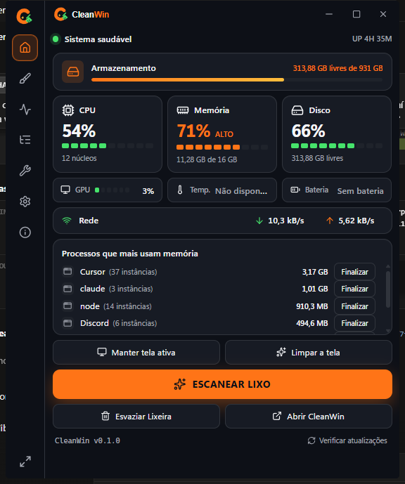
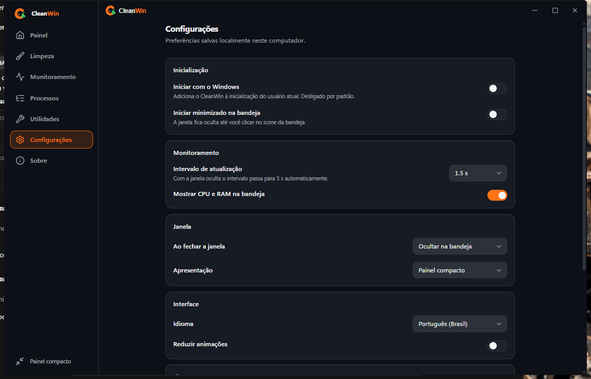
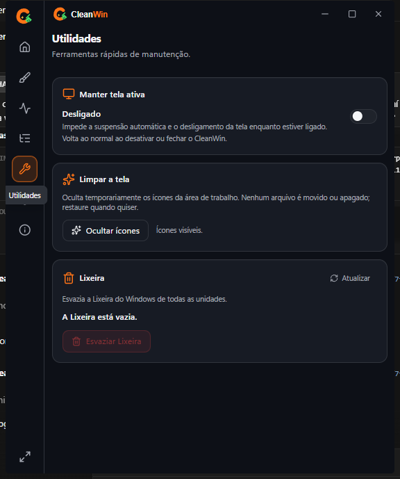
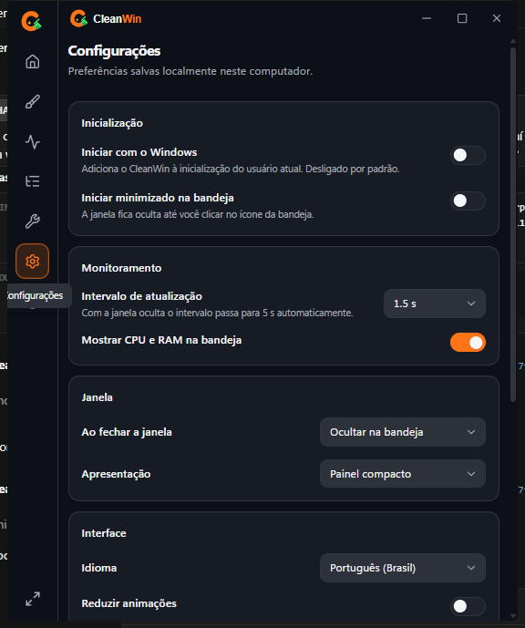
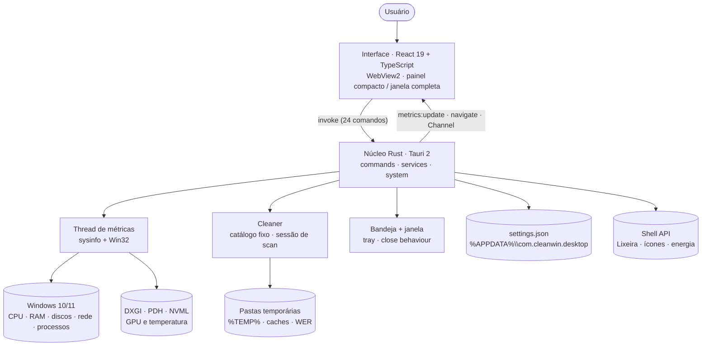
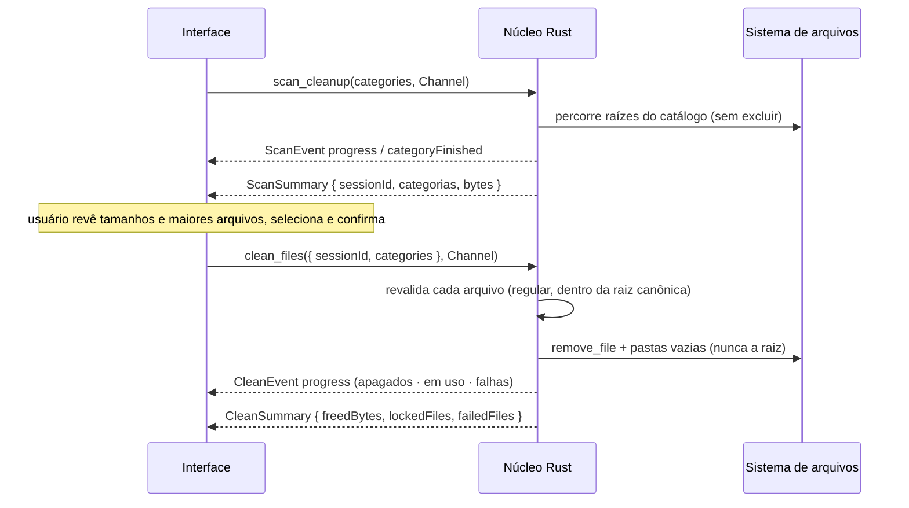

<p align="center">
  
</p>

# 🧹 CleanWin — Seu Windows, sob controle.


> 🖥️ Utilitário de sistema **open source** para Windows 10 e 11 que reúne, em uma janela leve, **monitoramento em tempo real** (CPU, RAM, disco, GPU, rede), **gerenciamento seguro de processos**, **limpeza de arquivos temporários com pré-visualização e confirmação** e **utilidades de manutenção** (Lixeira, manter tela ativa, limpar a área de trabalho) — sem telemetria, sem serviços em segundo plano, sem privilégios de administrador.
> Primeiro produto da linha **CleanWin** (desktop → futuras extensões descritas no roadmap).

Contexto de produto (o "porquê"): [`PROJECT_CONTEXT.md`](PROJECT_CONTEXT.md).

**📅 Entrega v0.1.0:** **04/nov/2026** · **Meta:** todas as funcionalidades obrigatórias ponta-a-ponta (dashboard real → processos → scanner → limpeza segura → utilidades → bandeja → instalador). O que entrou está no [`CHANGELOG`](docs/CHANGELOG.md).
**👥 Time:** Victor Alves (mantenedor — núcleo Rust, interface, documentação).

---

## 🧭 Visão geral

A visão de produto está em [`PROJECT_CONTEXT.md`](PROJECT_CONTEXT.md) e os requisitos em [`docs/PRD.md`](docs/PRD.md) — leia para entender o "porquê" por trás do que foi construído. O que vem a seguir é o resumo das decisões de arquitetura, stack e segurança tomadas em 04/nov/2026; o que **de fato** entrou está no [`CHANGELOG`](docs/CHANGELOG.md).

| Módulo                 | O que é                                                                                              | Status        |
| ---------------------- | ---------------------------------------------------------------------------------------------------- | ------------- |
| **Dashboard**          | Painel compacto (560×680) com estado do sistema, CPU/RAM/disco, GPU, rede, uptime, top processos e ações rápidas | ✅ Entregue   |
| **Monitoramento**      | CPU por núcleo + histórico, memória, unidades de disco, GPU, rede com histórico, bateria, temperatura (quando o hardware expõe) | ✅ Entregue   |
| **Processos**          | Lista com nome, PID, CPU, RAM; busca, ordenação, finalizar com confirmação e proteção de processos críticos | ✅ Entregue   |
| **Limpeza**            | Scanner de 7 categorias (nunca exclui), pré-visualização, seleção, confirmação, progresso, cancelamento, relatório | ✅ Entregue   |
| **Utilidades**         | Lixeira (consultar/esvaziar), manter tela ativa, ocultar/restaurar ícones da área de trabalho        | ✅ Entregue   |
| **Bandeja + Config**   | Ícone na bandeja, abrir/ocultar/sair, iniciar com o Windows (opt-in), iniciar minimizado, intervalo, idioma pt-BR/en-US | ✅ Entregue   |
| **Instalador**         | NSIS por usuário (sem UAC), WebView2 bootstrapper                                                    | ✅ Entregue   |
| **Auto-update / assinatura** | Atualização automática e assinatura de código                                                  | 🔜 Roadmap    |

**Loops do produto:** abrir → ver saúde do sistema → identificar o que pesa (processos) → escanear lixo → revisar e confirmar → limpar → ver espaço recuperado → continuar na bandeja.
**Diferenciais inegociáveis:** 🛡️ **Limpeza segura por sessão** (a interface nunca envia caminhos; o Rust só apaga o que ele mesmo listou, dentro de raízes canônicas) e 📊 **dados reais ou "Não disponível"** (nenhuma métrica inventada).

---

## 📸 Capturas de tela

Capturas reais do app em execução (build 0.1.0, Windows 11, escala 100 %):

| Painel compacto (560×680) | Janela completa — Configurações (1120×720) |
|---|---|
|  |  |

| Utilidades | Configurações (compacto) |
|---|---|
|  |  |

Mais capturas e regras em [`docs/assets/screenshots/`](docs/assets/screenshots/). A referência de composição continua sendo o mockup em [`public/assets/references/desktop-mockup.png`](public/assets/references/desktop-mockup.png).

| Arquivo esperado | Conteúdo |
| --- | --- |
| `compact-dashboard.png` | Painel compacto com métricas reais |
| `full-monitoring.png` | Janela completa — Monitoramento |
| `full-cleaning.png` | Janela completa — Limpeza (resultado do scan) |
| `tray.png` | Menu da bandeja |

---

## 📥 Download (usuário final)

| Arquivo | Versão | Plataforma | Observação |
|---|---|---|---|
| [`release/CleanWin_0.1.0_x64-setup.exe`](release/CleanWin_0.1.0_x64-setup.exe) | 0.1.0 | Windows 10/11 x64 | Instalador NSIS por usuário (sem UAC); SHA-256 em [`release/SHA256SUMS.txt`](release/SHA256SUMS.txt) |

O instalador ainda **não é assinado**: o SmartScreen mostra "editor desconhecido" na primeira execução (Mais informações → Executar assim mesmo). Ao publicar uma tag `v*`, o workflow de CI anexa o mesmo instalador à página de [Releases](https://github.com/Victorkaue333/cleanwin/releases).

---

## ✅ Pré-requisitos

Para desenvolver localmente, você precisa ter as seguintes ferramentas instaladas:

| Ferramenta                        | Versão                                        | Para quê                                        | Verificar            |
| --------------------------------- | --------------------------------------------- | ----------------------------------------------- | -------------------- |
| 🪟 **Windows**                    | 10 (1803+) ou 11, **x64**                     | Único alvo suportado (APIs Win32)               | `winver`             |
| 🟢 **Node.js**                    | **20+** (testado com 24)                      | Vite, ESLint, Vitest, Tauri CLI                 | `node -v`            |
| 📦 **pnpm**                       | **9+** (testado com 11)                       | Gerenciador de pacotes (não use npm/yarn)       | `pnpm -v`            |
| 🦀 **Rust (stable, MSVC)**        | **≥ 1.95** (testado com 1.99.1)               | Núcleo nativo (`sysinfo 0.40` exige 1.95)       | `rustc --version`    |
| 🧰 **VS Build Tools 2022**        | C++ build tools + Windows 10/11 SDK           | Toolchain MSVC e crate `windows`                | `cl.exe` no Developer Prompt |
| 🌐 **WebView2 Runtime**           | atual (já vem no Windows 10/11)               | Renderização da interface                       | Apps instalados      |

```powershell
# Rust stable atualizado (sysinfo 0.40 exige >= 1.95)
rustup update stable

# pnpm via corepack (ou npm i -g pnpm)
corepack enable
```

---

## 🏗️ Arquitetura

A arquitetura técnica é detalhada em [`docs/ARCHITECTURE.md`](docs/ARCHITECTURE.md) e aprofundada em [`docs/architecture/`](docs/architecture/) — leia para entender as decisões por trás da estrutura do código, da comunicação entre camadas e da segurança. O resumo visual:

```text
Janela nativa (Tauri 2, decorations: false) — WebView2
        ↓ IPC (invoke · eventos · Channel)
Núcleo Rust (src-tauri) — comandos · thread de métricas · cleaner · tray · settings
        ↓ sysinfo · windows (Win32/Shell/DXGI/PDH/WMI) · NVML (opcional)
Windows 10 / 11 — sem serviço, sem driver, sem elevação
        ↓
Persistência local — %APPDATA%\com.cleanwin.desktop\settings.json (JSON atômico) · logs em %LOCALAPPDATA%
```

### 🔗 Como os componentes se comunicam

| De → Para                           | Protocolo / mecanismo                                                                                                   |
| ----------------------------------- | ----------------------------------------------------------------------------------------------------------------------- |
| **React → Rust (comandos)**         | `invoke("<comando>", { args })` do `@tauri-apps/api/core`; 24 comandos, todos em [`docs/API.md`](docs/API.md)            |
| **Rust → React (métricas)**         | Evento `metrics:update` com o `SystemSnapshot` a cada intervalo (500–10 000 ms); **a UI não faz polling**                |
| **Rust → React (progresso)**        | `Channel<ScanEvent>` / `Channel<CleanEvent>` por chamada (scan e limpeza), nunca evento global                            |
| **Rust → React (navegação)**        | Evento `navigate` (bandeja → "Escanear lixo")                                                                            |
| **Erros**                           | Rejeição `{ code, message }` — `io`, `permission_denied`, `not_found`, `invalid_operation`, `protected`, `unsupported`, `busy`, `cancelled`, `internal` |
| **Rust → Windows**                  | `sysinfo` (CPU/RAM/discos/rede/processos/GPU/sensores) · `windows` crate (Shell, Power, Threading, WinInet, Security) · NVML (temperatura NVIDIA) |
| **Limpeza**                         | Sessão de scan em memória (30 min, uso único): a UI envia **ids de categoria + id de sessão**, nunca caminhos           |
| **Configurações**                   | `settings.json` com escrita atômica (temp + rename); `#[serde(default)]` tolera versões antigas                           |
| **Janela ↔ bandeja**                | Fechar = ocultar na bandeja ou sair (configurável); segunda instância foca a janela (`single-instance`)                   |

**Fluxo de inicialização (resumo):** `main.rs` → plugins (single-instance, log, opener, process, autostart) → `setup` carrega `settings.json`, cria o estado, monta a bandeja e inicia a thread de métricas → janela criada **oculta** → React monta, assina `metrics:update` e chama `frontend_ready` → a janela aparece (exceto `--minimized` / "iniciar minimizado").

### Diagramas

**Arquitetura e comunicação** (quem fala com quem):



> O núcleo Rust é o único que toca o sistema. A interface **não** recebe caminhos para excluir nem PIDs sem validação: todo comando destrutivo é revalidado no Rust (processos protegidos, raízes canônicas, arquivo regular, sem reparse points).

**Fluxo de limpeza (scan → confirmação → limpeza):**



---

## Stack do Projeto

As tecnologias escolhidas estão alinhadas com o briefing, o mockup e as restrições de produto (sem Electron, sem backend web, sem banco de dados); cada escolha tem ADR em [`docs/DECISIONS.md`](docs/DECISIONS.md). O resumo **vigente**:

- 🎨 **Interface:** React 19 · TypeScript estrito · Vite 8 · Tailwind CSS 4 (tokens de `public/assets/design-tokens`) · Zustand (um store por domínio) · lucide-react · sparklines em SVG (sem biblioteca de gráficos) · i18n pt-BR (fonte) + en-US
- ⚙️ **Núcleo nativo:** Rust ≥ 1.95 · Tauri 2 (`tray-icon`, `image-png`) · plugins oficiais `single-instance`, `log`, `opener`, `process`, `autostart` · `sysinfo` 0.40 · `windows` 0.62 · `nvml-wrapper` 0.13 · `serde` · `thiserror`
- 🪟 **Integração Windows:** DXGI + PDH (GPU), WMI (sensores), `SHQueryRecycleBinW`/`SHEmptyRecycleBinW`, `SetThreadExecutionState`, `WM_COMMAND 0x7402` (ícones da área de trabalho), `OpenProcess`/`TerminateProcess`, `InternetGetConnectedState`, `GetSystemPowerStatus`
- 📦 **Distribuição:** NSIS por usuário (`installMode: currentUser`), ícones de `public/assets/app-icons`, WebView2 bootstrapper
- 🧰 **Tooling:** pnpm · ESLint (TS + React Hooks) · Prettier · Vitest + jsdom + Testing Library · `cargo test` + `clippy -D warnings` · GitHub Actions (`windows-latest`)

> **Onde cada coisa roda:** a thread de métricas (Rust) amostra o sistema e empurra snapshots; scan e limpeza rodam em `spawn_blocking` com progresso por `Channel`; `SetThreadExecutionState` tem thread própria (o estado é por thread); a interface só formata, confirma e navega.

---

## 📂 Estrutura de pastas

A estrutura do código e da documentação — onde fica o quê. O resumo visual:

```text
cleanwin/
├── src/                         # interface React (features · components · stores · services · i18n · types)
│   ├── app/                     # App.tsx (shell, roteamento interno, modo compacto/completo)
│   ├── components/ui/           # Button, Card, Dialog, SegmentedMeter, ProgressBar, Toaster…
│   ├── features/                # dashboard · monitoring · processes · cleaning · utilities · settings
│   ├── stores/                  # Zustand: metrics · processes · cleaning · settings · ui · utilities · toast
│   ├── services/ipc.ts          # wrappers tipados de invoke/listen
│   ├── i18n/                    # pt-BR.ts (fonte) · en-US.ts
│   ├── lib/                     # format · thresholds · history · processes · errors · cn
│   └── types/ipc.ts             # espelho TS dos DTOs do Rust
├── src-tauri/                   # núcleo Rust
│   ├── src/commands/            # os 24 comandos IPC
│   ├── src/services/            # settings · metrics_loop · tray · window
│   ├── src/system/              # metrics · processes · cleaner · recycle_bin · power · desktop
│   ├── capabilities/            # permissões da janela main
│   ├── icons/                   # gerados de public/assets/app-icons
│   └── tauri.conf.json          # janela, CSP, bundle NSIS
├── public/assets/               # identidade oficial: branding/ · app-icons/ · design-tokens/ · references/
├── tests/                       # setup do Vitest
├── .github/                     # CI (windows-latest) + templates de issue
└── docs/                        # documentação (ver "Documentação")
```

---

## ⚙️ Setup local detalhado

> Objetivo: do `git clone` ao app rodando **sem perguntar nada**. Não há segredos, `.env` nem serviços externos. Execute tudo na **raiz do repositório**, na ordem abaixo (conferido contra `package.json`, `src-tauri/Cargo.toml` e `tauri.conf.json` em 04/nov/2026).

### 0️⃣ Pré-requisitos

Ver a tabela acima. Resumo: Windows x64 · Node 20+ · pnpm 9+ · Rust ≥ 1.95 (MSVC) · VS Build Tools 2022 com Windows SDK.

```powershell
rustup update stable          # >= 1.95
corepack enable               # pnpm
```

### 1️⃣ Clone

```powershell
git clone https://github.com/Victorkaue333/cleanwin.git
cd cleanwin
```

### 2️⃣ Instalação

```powershell
pnpm install
```

Instala as dependências do frontend **e** a Tauri CLI (`@tauri-apps/cli`). Não há `postinstall`. O Rust baixa os crates na primeira compilação.

> **Nunca rode o install com o `pnpm tauri dev` ligado** — no Windows o processo em execução segura arquivos do `node_modules` e o install termina com a árvore corrompida.

### 3️⃣ Variáveis de ambiente

**Nenhuma.** O CleanWin não lê `.env`. As únicas variáveis reconhecidas são de build (`TAURI_DEV_HOST`, `TAURI_ENV_DEBUG`) — ver [`docs/ENVIRONMENT.md`](docs/ENVIRONMENT.md).

### 4️⃣ Rodar

```powershell
pnpm tauri dev
```

Compila o Rust (a primeira vez leva alguns minutos), sobe o Vite em `http://localhost:1420` (`beforeDevCommand`) e abre a janela com HMR. Logs do Rust em `stdout` e em `%LOCALAPPDATA%\com.cleanwin.desktop\logs`.

> `pnpm dev` sozinho sobe **só o Vite** — útil para CSS, mas toda chamada IPC falha fora do Tauri.

### 5️⃣ Verificação

```powershell
pnpm typecheck      # tsc -b --noEmit
pnpm lint           # ESLint
pnpm test           # Vitest (jsdom)
pnpm test:rust      # cargo test (usa tempdir; nunca toca pastas reais)
cargo clippy --manifest-path src-tauri/Cargo.toml --tests -- -D warnings
pnpm build          # build de produção do frontend (dist/)
```

### 6️⃣ Build e instalador

```powershell
pnpm tauri build
# src-tauri\target\release\cleanwin.exe
# src-tauri\target\release\bundle\nsis\CleanWin_0.1.0_x64-setup.exe
```

Detalhes em [`docs/DEPLOY.md`](docs/DEPLOY.md).

---

## 📋 Comandos úteis

**Todos** os scripts reais do repositório, auditados do `package.json` e do `Cargo.toml` (04/nov/2026).

### Raiz (`package.json`)

| Comando            | O que faz                                                                                  |
| ------------------ | ------------------------------------------------------------------------------------------ |
| `pnpm tauri dev`   | App completo em modo dev (Rust + Vite + HMR)                                               |
| `pnpm tauri build` | Executável + instalador NSIS em `src-tauri/target/release/bundle/nsis/`                    |
| `pnpm tauri icon <png> -o src-tauri/icons` | Regenera os ícones a partir de `public/assets/app-icons/icon-1024.png` |
| `pnpm dev`         | Só o Vite (`:1420`) — sem IPC                                                              |
| `pnpm build`       | `tsc -b && vite build` → `dist/`                                                           |
| `pnpm preview`     | Serve o `dist/` (sem IPC)                                                                  |
| `pnpm typecheck`   | `tsc -b --noEmit`                                                                          |
| `pnpm lint`        | ESLint (TypeScript + React Hooks + React Refresh)                                          |
| `pnpm format`      | Prettier em `src/**/*.{ts,tsx,css}`                                                        |
| `pnpm test` / `pnpm test:watch` | Vitest (jsdom, Testing Library)                                               |
| `pnpm test:rust`   | `cargo test --manifest-path src-tauri/Cargo.toml`                                          |

### Núcleo Rust (`src-tauri`)

| Comando                                              | O que faz                                                 |
| ---------------------------------------------------- | --------------------------------------------------------- |
| `cargo check --tests`                                | Type-check rápido, incluindo testes                       |
| `cargo test`                                         | Testes (settings, cleaner, processes, metrics, power…)    |
| `cargo clippy --tests -- -D warnings`                | Lint bloqueante                                           |
| `cargo fmt`                                          | Formatação                                                |
| `cargo build --release`                              | Binário de release sem bundling                           |

### Execução

| Comando                                               | O que faz                                            |
| ----------------------------------------------------- | ---------------------------------------------------- |
| `src-tauri\target\debug\cleanwin.exe --minimized`     | Simula o início pela entrada de autostart (bandeja)  |
| `%APPDATA%\com.cleanwin.desktop\settings.json`        | Preferências (apagar = volta ao padrão)              |
| `%LOCALAPPDATA%\com.cleanwin.desktop\logs\`           | Logs rotacionados (2 MB)                             |

---

## 📖 Documentação

**Padrão de documentação AEX (docs canônicos)** — camada fina e autoritativa que resume e aponta para a documentação detalhada:

| Documento | Conteúdo |
|-----------|----------|
| [`PROJECT_CONTEXT.md`](PROJECT_CONTEXT.md) | Contexto de produto e do problema. |
| [`CLAUDE.md`](CLAUDE.md) | Regras para a IA atuar no repositório. |
| [`docs/PRD.md`](docs/PRD.md) | Requisitos do produto. |
| [`docs/ARCHITECTURE.md`](docs/ARCHITECTURE.md) | Arquitetura e decisões estruturais. |
| [`docs/API.md`](docs/API.md) | Comandos IPC, eventos, contratos e exemplos. |
| [`docs/DATABASE.md`](docs/DATABASE.md) | Persistência local (não há banco de dados). |
| [`docs/DEPLOY.md`](docs/DEPLOY.md) | Build, instalador e publicação. |
| [`docs/ENVIRONMENT.md`](docs/ENVIRONMENT.md) | Variáveis de ambiente e caminhos em runtime. |
| [`docs/DECISIONS.md`](docs/DECISIONS.md) | Registro de decisões técnicas (ADRs). |
| [`docs/CHANGELOG.md`](docs/CHANGELOG.md) | Histórico de mudanças por versão. |
| [`docs/DESIGN.md`](docs/DESIGN.md) | Guia rápido de design (tokens, identidade, componentes). |
| [`docs/Code-Style.md`](docs/Code-Style.md) | Como o código é escrito (Rust + TypeScript). |
| [`docs/INDEX.md`](docs/INDEX.md) | Mapa de toda a documentação. |

> Os canônicos resumem e linkam o detalhamento em [`docs/project-context/`](docs/project-context/), [`docs/architecture/`](docs/architecture/), [`docs/api/`](docs/api/) e [`docs/development/`](docs/development/). O relatório de implementação e validação está em [`docs/qa/implementation-report.md`](docs/qa/implementation-report.md).

### Ordem de leitura (aprofundamento)

1. [`CLAUDE.md`](CLAUDE.md) — regras fixas e guardrails (ler primeiro em toda sessão)
2. [`PROJECT_CONTEXT.md`](PROJECT_CONTEXT.md) + [`docs/PRD.md`](docs/PRD.md) — o quê e para quem
3. [`docs/ARCHITECTURE.md`](docs/ARCHITECTURE.md) → [`docs/architecture/security.md`](docs/architecture/security.md) — como e por que é seguro
4. [`docs/API.md`](docs/API.md) — o contrato entre React e Rust
5. [`docs/DECISIONS.md`](docs/DECISIONS.md) — os ADRs
6. [`docs/development/`](docs/development/) — setup, testes, build
7. [`docs/CHANGELOG.md`](docs/CHANGELOG.md) — o que de fato entrou

---

## 🔐 Segurança (resumo)

- **Menor privilégio:** roda como o usuário; instalador por usuário; nunca eleva. Pastas que exigem admin (`C:\Windows\Temp`, `ProgramData\…\WER`) são analisadas parcialmente e marcadas como parciais.
- **Limpeza:** catálogo fixo de raízes validado por `is_safe_root` (nunca raiz de unidade, perfil, `Windows`, `System32`, `Program Files`, pastas pessoais); sem seguir junções/symlinks; scan ≠ exclusão; cada arquivo revalidado antes do `remove_file`; arquivos em uso são reportados, nunca forçados; arquivos modificados nas últimas 24 h são pulados por padrão.
- **Processos:** confirmação na UI **e** recusa no Rust para PID 0/4, o próprio CleanWin e processos críticos (`csrss`, `wininit`, `winlogon`, `services`, `lsass`, `svchost`, `dwm`, `smss`, `Memory Compression`, `Registry`, …).
- **IPC:** só os 24 comandos documentados; CSP `default-src 'self'`; `open_external` só `http(s)`; `reveal_path` só para caminhos que o próprio app reportou.
- **Registro:** a única escrita é a entrada de autostart (`HKCU\…\Run`), opt-in e removida ao desativar.
- **Rede/telemetria:** nenhuma. "Verificar atualizações" abre a página de releases no navegador.

Detalhes: [`docs/architecture/security.md`](docs/architecture/security.md).

## ⚠️ Limitações conhecidas (v0.1)

- Temperatura de CPU depende de sensores expostos via WMI (`MSAcpi_ThermalZoneTemperature`), geralmente vazios sem elevação → "Não disponível".
- Temperatura de GPU apenas em NVIDIA (NVML); utilização e VRAM funcionam para qualquer fabricante via DXGI/PDH.
- Instalador **não assinado**: o SmartScreen avisa na primeira execução.
- Sem atualização automática (roadmap).
- Somente x64; ARM64 no roadmap.

---

## 📏 Convenções

- **Zero invenção:** toda métrica vem do sistema; quando o hardware não expõe, a interface diz "Não disponível". Nenhum dado simulado fora de fixtures de teste.
- **TS estrito** (zero `any`) · **Rust** com `clippy -D warnings`, erros via `AppError { code, message }`, nada de `unwrap()` em caminhos que dependem do sistema.
- **Identidade visual só de `public/assets`**: logos, ícones e tokens não são recriados nem recortados de capturas; cor sempre por token Tailwind, nunca hex solto.
- **Strings de interface em `src/i18n`** (pt-BR é a fonte; en-US no mesmo PR).
- **Ação destrutiva = confirmação na UI + validação no Rust.** Nova categoria de limpeza exige raiz segura, testes de scan/limpeza e texto explicando o que será removido.
- **Conventional Commits** (`feat:`, `fix:`, `docs:`, `test:`, `chore:`) · PR com CI verde · sem dependência nova sem justificativa.

---

## 🗺️ Roadmap

- **v0.1 (04/nov/2026) — entregue:** dashboard compacto e janela completa com métricas reais · processos com proteção · scanner + limpeza segura (7 categorias) · Lixeira · manter tela ativa · ícones da área de trabalho · bandeja · configurações persistentes · instalador NSIS · CI.
- **v0.2:** assinatura de código · auto-update (`tauri-plugin-updater`) · categorias adicionais com consentimento específico (Windows Update cache, Delivery Optimization) em modo elevado opcional por sessão · visualizador de espaço por pasta com exclusão **por seleção explícita** · sensores adicionais.
- **v0.3:** programas de inicialização · histórico de limpezas · alertas configuráveis · ARM64.
- **Fora de escopo (decisão de produto):** "otimização de RAM", encerramento automático de processos, limpeza de Registro, telemetria, serviços em segundo plano, drivers.

Detalhe: [`docs/project-context/roadmap.md`](docs/project-context/roadmap.md).

---

## ⚖️ Créditos de terceiros

Dependências embarcadas ou exibidas pelo produto, com a licença que as cobre.

| Ativo | Onde aparece | Licença | Obrigação |
|-------|--------------|---------|-----------|
| **[Tauri](https://tauri.app)** e plugins oficiais | Runtime da janela, IPC, bandeja, autostart, log, opener | MIT / Apache-2.0 | Aviso de licença no instalador (`licenseFile`) |
| **[sysinfo](https://github.com/GuillaumeGomez/sysinfo)** | Métricas de CPU, RAM, discos, rede, processos, GPU, sensores | MIT | Nenhuma no produto |
| **[windows-rs](https://github.com/microsoft/windows-rs)** | Chamadas Win32/Shell/DXGI/PDH | MIT / Apache-2.0 | Nenhuma no produto |
| **[nvml-wrapper](https://github.com/Cldfire/nvml-wrapper)** | Temperatura de GPU NVIDIA (opcional em runtime) | MIT / Apache-2.0 | Nenhuma no produto |
| **[React](https://react.dev)** · **[Zustand](https://github.com/pmndrs/zustand)** · **[Tailwind CSS](https://tailwindcss.com)** · **[Vite](https://vite.dev)** | Interface | MIT | Nenhuma no produto |
| **[Lucide](https://lucide.dev)** | Todo ícone funcional da interface | ISC | Nenhuma no produto |
| **[Inter](https://rsms.me/inter/)** | Tipografia do logotipo horizontal (SVG com fallback Arial); a interface usa a pilha do sistema | SIL OFL 1.1 | Nenhuma no produto (fonte não redistribuída) |
| **[NSIS](https://nsis.sourceforge.io)** | Instalador gerado pelo Tauri | zlib/libpng | Nenhuma no produto |

> Acrescentar dependência com licença que exija atribuição, aviso ou *share-alike* pede linha nesta tabela **e** registro em [`docs/DECISIONS.md`](docs/DECISIONS.md) — no mesmo PR.

---

## 🆘 Ajuda

- **Dúvida de escopo** → [`docs/PRD.md`](docs/PRD.md) responde. **Divergência** → abra uma issue (templates em `.github/ISSUE_TEMPLATE/`).
- **Bug de limpeza ou processo** → inclua o log de `%LOCALAPPDATA%\com.cleanwin.desktop\logs` e a versão (rodapé do app).
- **Contribuições** → [`CONTRIBUTING.md`](CONTRIBUTING.md).

<p align="center">

MIT © 2026 Victor Alves — código aberto, sem telemetria, sem garantia (ver [`LICENSE`](LICENSE)).

</p>

<small>Última atualização: 04/novembro/2026 — stack, comandos, links e roadmap reconferidos contra o código.</small>
