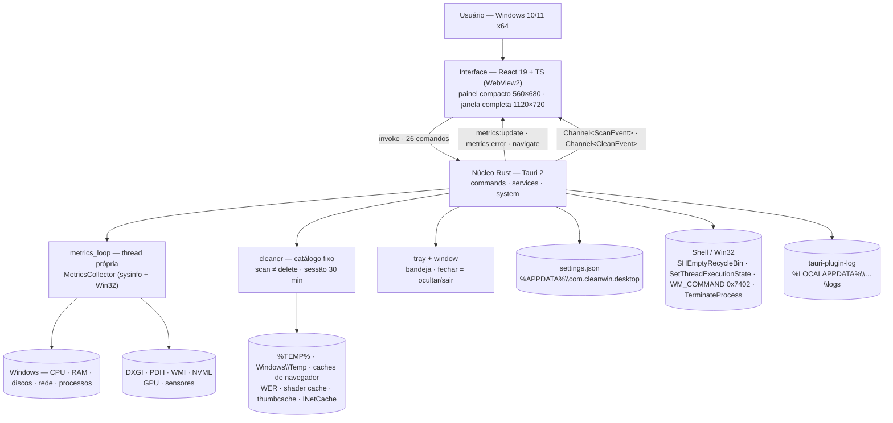

# ARCHITECTURE — CleanWin

> Camada **autoritativa e concisa** da arquitetura. O detalhamento e o "porquê" ficam nos docs-fonte: [`../CLAUDE.md`](../CLAUDE.md) (regras fixas) · [`architecture/overview.md`](architecture/overview.md) · [`architecture/native-backend.md`](architecture/native-backend.md) (núcleo Rust) · [`architecture/data-flow.md`](architecture/data-flow.md) · [`architecture/security.md`](architecture/security.md).
> Última atualização: 04/nov/2026 · Verificado contra `src-tauri/src/**` e `src-tauri/tauri.conf.json`.

## Visão geral

CleanWin é uma aplicação desktop **Tauri 2**: um núcleo **Rust** que detém toda interação com o Windows e uma interface **React 19 + TypeScript** renderizada pelo WebView2 na mesma janela nativa. Não há servidor HTTP, banco de dados, conta ou rede — o único "backend" é o processo local.

Princípio norteador: **o Rust é o único que toca o sistema; a interface formata, confirma e navega.** Regra estrutural acima de todas: **nenhum caminho de arquivo e nenhuma ação destrutiva nasce na interface** — a limpeza trabalha por sessão de scan guardada no Rust e os processos são revalidados contra a lista de protegidos antes de qualquer handle ser aberto.

## Diagrama de componentes

## Camadas e responsabilidades

| Camada | Responsabilidade | Neste projeto |
|--------|------------------|---------------|
| **Interface** | Apresentação, navegação, formatação, confirmações, histórico para gráficos. | `src/` — React 19, TypeScript estrito, Vite 8, Tailwind 4 com tokens de `public/assets/design-tokens`, Zustand (um store por domínio: métricas, processos, limpeza, configurações, UI, utilidades, toasts), lucide-react, sparklines em SVG, i18n pt-BR/en-US. **Nunca** toca sistema de arquivos, processos ou Registro; nunca inventa dado (skeleton até o primeiro snapshot). |
| **Comandos IPC** | Superfície de ataque controlada. | `src-tauri/src/commands/mod.rs` — 26 comandos `#[tauri::command]`, validação de entrada, trabalho pesado em `spawn_blocking`, progresso por `Channel`. Permissões em `capabilities/default.json` (só a janela `main`). |
| **Serviços** | Estado gerenciado e ciclo de vida. | `services/` — `AppState` (settings, métricas, cleaner, keep-awake, desktop, flags), `metrics_loop` (thread + evento), `tray` (menu e status), `window` (modos, mostrar/ocultar, saída com cleanup), `settings` (JSON atômico). |
| **Sistema** | Toda chamada nativa. | `system/` — `metrics` (sysinfo + `GetSystemPowerStatus` + `InternetGetConnectedState` + NVML), `processes` (`OpenProcess`/`TerminateProcess` + protegidos), `cleaner` (catálogo, `is_safe_root`, walk sem reparse points, delete revalidado), `recycle_bin`, `power` (thread dedicada para `SetThreadExecutionState`), `desktop` (`SHELLDLL_DefView` + `WM_COMMAND 0x7402`). |
| **Persistência** | Preferências e logs. | `settings.json` com escrita atômica em `app_config_dir`; logs rotacionados (2 MB) em `app_log_dir`. Sessão de scan em memória (30 min, uso único). Não há banco de dados — [`DATABASE.md`](DATABASE.md). |
| **Distribuição** | Executável e instalador. | `tauri.conf.json`: NSIS por usuário, WebView2 bootstrapper, ícones gerados de `public/assets/app-icons`. CI em `windows-latest` ([`DEPLOY.md`](DEPLOY.md)). |

**Módulos do núcleo** (`src-tauri/src/`): `commands` · `errors` (`AppError { code, message }`) · `models` (DTOs camelCase) · `services/{settings, metrics_loop, tray, window}` · `system/{metrics, processes, cleaner, recycle_bin, power, desktop}`. Entrada: `lib.rs::run()` (plugins → `setup` → `on_window_event` → `invoke_handler` → `run` com cleanup em `ExitRequested`/`Exit`).

**Interface** (`src/`): `app/` (shell) · `features/{dashboard, monitoring, processes, cleaning, utilities, settings}` · `components/{ui, layout, shared}` · `stores/` · `services/ipc.ts` · `i18n/` · `lib/` · `types/ipc.ts`. Detalhe em [`architecture/frontend.md`](architecture/frontend.md).

## Integrações externas

Não há serviço externo em runtime. As integrações são com o próprio Windows, todas atrás de módulos em `system/`:

| Integração | Uso | Observações |
|------------|-----|-------------|
| **sysinfo 0.40** | CPU, RAM, discos, rede, processos, GPU (DXGI + PDH), sensores (WMI) | Um `System` persistente refrescado em thread própria; CPU precisa de dois samples. |
| **windows 0.62** | Shell (`SHQueryRecycleBinW`, `SHEmptyRecycleBinW`), Power (`SetThreadExecutionState`, `GetSystemPowerStatus`), Threading (`OpenProcess`, `TerminateProcess`), WindowsAndMessaging (`FindWindowExW`, `SendMessageW`), WinInet, Security (`TokenElevation`) | Features mínimas no `Cargo.toml`; todo `unsafe` comentado. |
| **nvml-wrapper 0.13** | Temperatura de GPU NVIDIA | `Nvml::init().ok()`; ausente → `temperatureC: null`. |
| **Plugins Tauri** | `single-instance` (foco na 2ª instância), `log`, `opener` (URL/pasta), `process`, `autostart` (HKCU Run com `--minimized`) | Oficiais, versões pinadas em `Cargo.lock`. |
| **GitHub Releases** | "Verificar atualizações" | Abre a página no navegador via `open_external`; sem download pelo app. |

## Decisões-chave

Resumo estrutural; contexto e consequências completos em [`DECISIONS.md`](DECISIONS.md).

- **ADR-01** — Tauri 2 + Rust (não Electron): binário pequeno, Win32 direto, permissões por capability.
- **ADR-04** — Loop de métricas em thread Rust com evento `metrics:update` (não polling): uma fonte, CPU correta, bandeja viva com janela oculta.
- **ADR-05** — `sysinfo` 0.40 como base (já implementa DXGI/PDH para GPU) → exige Rust ≥ 1.95.
- **ADR-07** — Limpeza por sessão de scan: a interface envia ids, nunca caminhos; exclusão revalida cada arquivo.
- **ADR-08** — Catálogo fixo de categorias com `is_safe_root`; pastas arbitrárias ficam fora.
- **ADR-10** — `TerminateProcess` direto com lista de protegidos (erro real ao usuário).
- **ADR-11/12** — Thread dedicada para `SetThreadExecutionState`; ícones da área de trabalho via `WM_COMMAND 0x7402` (sem Registro).
- **ADR-13** — `settings.json` com escrita atômica (sem banco, sem plugin-store).
- **ADR-15** — Instalador NSIS por usuário (sem UAC, sem WiX).
- **ADR-16** — Dois modos de janela (compacto/completo) na mesma janela nativa.
- **ADR-18** — Identidade visual exclusivamente de `public/assets` (logo gerado por IA rejeitado).

## Estratégia de evolução

**v0.1 primeiro:** um binário, zero serviços, zero rede. Custo de operação: nenhum.

**Como cresce, sem reescrita:**

1. **Nova categoria de limpeza** — uma entrada em `cleaner::categories()` com raiz validada + testes; a interface só traduz o id. Categorias que exigem elevação entram como **modo elevado opcional por sessão** (B3), nunca como elevação permanente.
2. **Nova métrica** — campo novo no `SystemSnapshot` (`models`) + coleta no `MetricsCollector`; `#[serde(default)]`/`Option` mantêm compatibilidade com a interface.
3. **Auto-update e assinatura** (B1/B2) — `tauri-plugin-updater` com releases assinadas no GitHub; o link manual de hoje é o fallback.
4. **ARM64** (B8) — alvo adicional no CI; o código não tem dependência de arquitetura além do `windows` crate.

**O que não entra agora, e o gatilho:**

| Não fazer agora | Gatilho |
|---|---|
| Elevação (UAC) para limpar `Windows\Temp` completo | Pedido explícito do usuário por sessão (B3), nunca no boot |
| Banco de dados local (SQLite) | Histórico de limpezas (B6) com consultas que o JSON não atende |
| Biblioteca de gráficos | Mais de 2 séries simultâneas ou zoom/brush — hoje sparklines SVG bastam |
| Serviço em segundo plano | Nenhum: a bandeja + intervalo adaptativo cobrem o caso de uso |

---

Persistência: [`DATABASE.md`](DATABASE.md) · Contrato IPC: [`API.md`](API.md) · Decisões: [`DECISIONS.md`](DECISIONS.md) · Segurança: [`architecture/security.md`](architecture/security.md)
