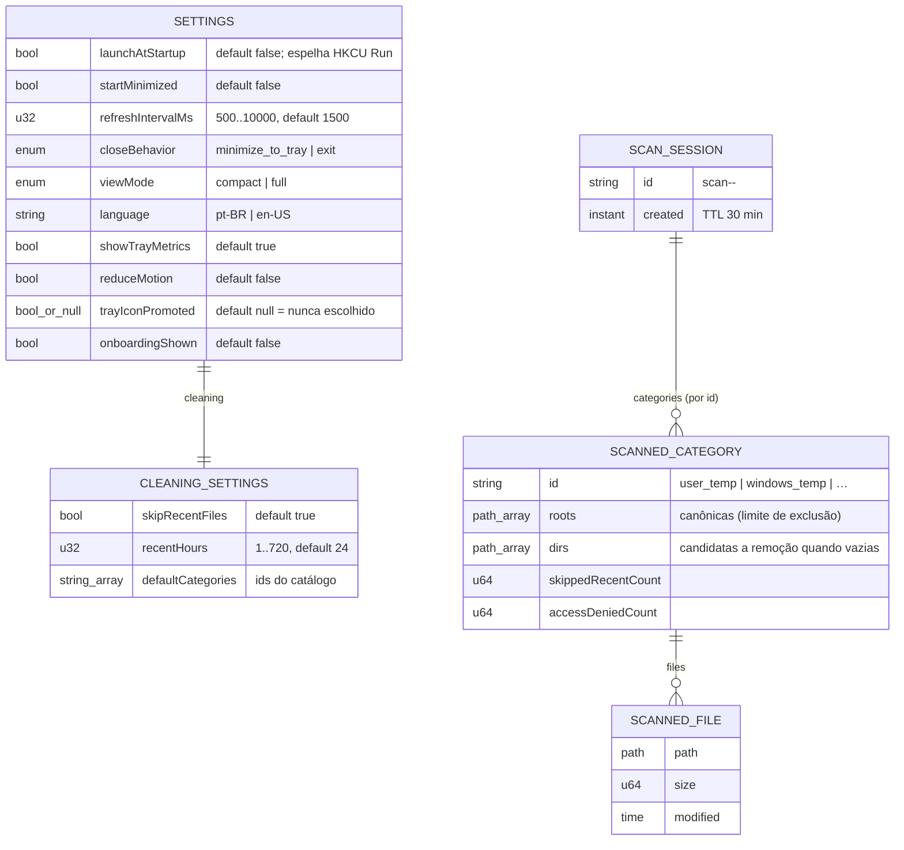

# DATABASE — CleanWin

> Camada canônica AEX, concisa e autoritativa. **Não há banco de dados** no CleanWin: este documento descreve a **persistência local** (arquivo de configurações, logs e a sessão de scan em memória) com a mesma estrutura dos outros canônicos.
> **Fonte da verdade viva do formato:** [`src-tauri/src/services/settings.rs`](../src-tauri/src/services/settings.rs) (`Settings`, `SettingsStore`, `write_atomic`) e [`src-tauri/src/system/cleaner.rs`](../src-tauri/src/system/cleaner.rs) (`ScanSession`, `CleanerState`) — em caso de divergência, o código prevalece.
> Relacionados: [`ARCHITECTURE.md`](ARCHITECTURE.md) · [`API.md`](API.md) · [`DECISIONS.md`](DECISIONS.md) (ADR-13) · [`../CLAUDE.md`](../CLAUDE.md).

## Visão geral

- **SGBD:** nenhum. Decisão de produto e arquitetura (ADR-13): preferências cabem em um JSON; nada precisa de consulta, índice ou histórico.
- **Ambiente:** arquivos locais no perfil do usuário, criados sob demanda pelo próprio app. Nada é compartilhado entre usuários do Windows.
- **"ORM":** `serde` + `serde_json`, com `#[serde(rename_all = "camelCase", default)]` — campo novo não quebra arquivo antigo; campo desconhecido é ignorado.
- **Regra de ouro:** **escrita atômica** (arquivo temporário + `rename`) e **sanitização na leitura e na escrita** (`Settings::sanitized`) — um arquivo editado à mão ou corrompido nunca derruba o app.

| Armazenamento | Dono | Papel |
|---------------|------|-------|
| `settings.json` | `services::settings` | Preferências do usuário (única persistência durável do app). |
| `logs/` | `tauri-plugin-log` | Diagnóstico; rotação em 2 MB (`KeepOne`). |
| `ScanSession` (memória) | `system::cleaner` + `CleanerState` | Lista de arquivos encontrados pelo scan; vive 30 min, uso único, nunca vai a disco. |
| `HKCU\…\Run\CleanWin` | `tauri-plugin-autostart` | Única escrita de Registro; só existe com `launchAtStartup = true`. |

**Convenções:** chaves camelCase; enums em `snake_case` (`"minimize_to_tray"`, `"compact"`); bytes nunca persistidos (o app não guarda métricas); caminhos nunca persistidos (as raízes de limpeza são recalculadas a cada scan a partir das variáveis de ambiente do usuário).

## Diagrama



## Arquivos

### `settings.json`

- **Caminho:** `%APPDATA%\com.cleanwin.desktop\settings.json` (`app_config_dir()`).
- **Ciclo:** lido uma vez no `setup` (`SettingsStore::load`); ausente → defaults, sem criar o arquivo; inválido → defaults e o arquivo vira `settings.json.invalid` para inspeção. Toda alteração (`update_settings`, `set_view_mode`) passa por `replace` → `sanitized` → `write_atomic` (`settings.json.tmp` + `rename`).
- **Exemplo (defaults):**

```json
{
  "launchAtStartup": false,
  "startMinimized": false,
  "refreshIntervalMs": 1500,
  "closeBehavior": "minimize_to_tray",
  "viewMode": "compact",
  "language": "pt-BR",
  "showTrayMetrics": true,
  "reduceMotion": false,
  "trayIconPromoted": null,
  "onboardingShown": false,
  "cleaning": {
    "skipRecentFiles": true,
    "recentHours": 24,
    "defaultCategories": ["user_temp", "windows_temp", "crash_reports", "shader_cache"]
  }
}
```

- **Sanitização:** `refreshIntervalMs` em 500–10 000; `recentHours` em 1–720; `language` fora de `pt-BR`/`en-US` volta para `pt-BR`; categorias vazias removidas e deduplicadas.
- **Efeitos colaterais aplicados pelo Rust ao salvar:** intervalo da thread de métricas; entrada de autostart (criada/removida só quando o flag muda, com rollback do flag se o plugin falhar); tamanho da janela quando o modo muda.

### `logs/`

- **Caminho:** `%LOCALAPPDATA%\com.cleanwin.desktop\logs\` (`app_log_dir()`); também `stdout` em dev.
- **Nível:** `debug` em dev, `info` em release; `tao`/`wry` em `warn`. Nunca registra conteúdo de arquivos nem caminhos de arquivos pessoais — só raízes do catálogo e contagens.

### Sessão de scan (memória)

- Criada por `scan_cleanup`, guardada em `CleanerState.session` (uma por vez). `clean_files` a **consome** (`take_session`) — segunda limpeza exige novo scan. Expira em 30 min (`SESSION_TTL`) para nunca apagar com base em uma lista velha.
- Só a lista de caminhos vive aqui; nada é escrito em disco e nada chega à interface além dos 40 maiores arquivos por categoria (pré-visualização).

## Migrations

Não existem. Compatibilidade entre versões é garantida por `#[serde(default)]`: campo novo recebe o default; campo removido é ignorado na leitura e some na próxima escrita. Mudança de **semântica** de um campo existente exige renomear a chave (nunca reinterpretar o valor antigo) e uma linha no [`CHANGELOG.md`](CHANGELOG.md).

## Backup e reset

- **Reset para o padrão:** apagar `settings.json` (o app recria com defaults na próxima escrita). Desligar "Iniciar com o Windows" antes, ou remover a entrada `HKCU\Software\Microsoft\Windows\CurrentVersion\Run\CleanWin` à mão.
- **Backup:** copiar o arquivo. Não há dado do usuário além dele.

---

Arquitetura: [`ARCHITECTURE.md`](ARCHITECTURE.md) · Variáveis e caminhos: [`ENVIRONMENT.md`](ENVIRONMENT.md) · Testes de persistência: `services/settings.rs` (`#[cfg(test)]`, roundtrip, inválido, clamping)
