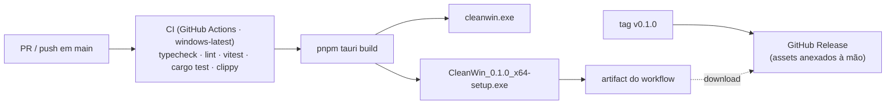

# DEPLOY — CleanWin

> Documento canônico AEX. Camada autoritativa e concisa do processo de build e publicação — resume e linka, não duplica.
> Fonte das decisões fixas: [`../CLAUDE.md`](../CLAUDE.md) · Passo a passo: [`development/build.md`](development/build.md) · Variáveis e caminhos: [`ENVIRONMENT.md`](ENVIRONMENT.md).
> Última atualização: 04/nov/2026.

## Visão geral

Não há servidor, container ou plataforma de hospedagem: o "deploy" do CleanWin é **gerar o executável e o instalador** e **publicá-los como assets de uma GitHub Release**. A publicação é manual (tag `v*`), com o build validado pelo CI em `windows-latest`.

> **Sem assinatura de código (v0.1):** o SmartScreen exibe "editor desconhecido" na primeira execução. Assinar (B1) é o primeiro item do roadmap de distribuição.
> **Sem auto-update (v0.1):** "Verificar atualizações" abre a página de releases no navegador (`open_external`). `tauri-plugin-updater` entra com releases assinadas (B2).

## Ambientes

| Ambiente | Como roda | Build | Dados |
|----------|-----------|-------|-------|
| **dev / local** | `pnpm tauri dev` (Vite `:1420` + Rust debug) | `src-tauri/target/debug/cleanwin.exe` | `settings.json` e logs do usuário (mesmos caminhos da release) |
| **release local** | `pnpm tauri build` | `src-tauri/target/release/cleanwin.exe` + `bundle/nsis/CleanWin_<versão>_x64-setup.exe` | idem |
| **publicado** | instalador baixado da Release | asset da tag `v*` | `%LOCALAPPDATA%\CleanWin\` (instalação por usuário) |

- **Dev:** logs em `stdout` (nível `debug`) e em `%LOCALAPPDATA%\com.cleanwin.desktop\logs`. `src-tauri\target\debug\cleanwin.exe --minimized` simula o início pela entrada de autostart.
- **Release:** mesmo identificador (`com.cleanwin.desktop`), logo dev e release **compartilham** `settings.json`.

## Pipeline

Um workflow em [`../.github/workflows/`](../.github/workflows/) (Node 20 + pnpm, `pnpm install --frozen-lockfile`, Rust stable ≥ 1.95):

| Workflow | Gatilho | O que faz |
|----------|---------|-----------|
| **ci** (`ci.yml`) | PR + push em `main` | `pnpm typecheck` · `pnpm lint` · `pnpm test` · `cargo test` · `cargo clippy --tests -- -D warnings` · `pnpm tauri build`; publica o instalador como artifact do workflow |

Passos por release:

1. **Subir a versão** em três lugares, iguais: `package.json`, `src-tauri/Cargo.toml`, `src-tauri/tauri.conf.json` (`version`). O rodapé da interface lê a versão via `get_app_info`.
2. **Registrar no [`CHANGELOG.md`](CHANGELOG.md)** (seção da versão com data).
3. **Abrir PR** → CI verde (inclui o `tauri build`).
4. **Mergear em `main`** e criar a tag `vX.Y.Z`.
5. O CI anexa `CleanWin_X.Y.Z_x64-setup.exe` e `SHA256SUMS.txt` à GitHub Release com as notas do changelog.
6. **Verificar** o instalador numa VM limpa: instala sem UAC, abre, bandeja funciona, desinstala limpo.

## Publicar uma release (passo a passo)

Não é necessário o `gh` CLI: publicar é `git push` da branch e da tag; o CI cria a Release.

1. Conferir `git status` limpo e a versão igual em `package.json`, `src-tauri/Cargo.toml` e `src-tauri/tauri.conf.json`.
2. Atualizar `release/RELEASE_NOTES.md` e `docs/CHANGELOG.md`.
3. A tag local `v0.1.0` já existe para a primeira versão. Para as próximas: `git tag -a vX.Y.Z -m "CleanWin vX.Y.Z"`.
4. `git push origin main` e `git push origin vX.Y.Z`.
5. O CI (`.github/workflows/ci.yml`) roda typecheck/lint/testes/clippy, faz `pnpm tauri build`, gera `SHA256SUMS.txt` e cria a Release com o instalador anexado.
6. Conferir em `https://github.com/Victorkaue333/cleanwin/releases/latest` que o `.exe` e o `SHA256SUMS.txt` estão anexados e que o link `releases/latest/download/<arquivo>` baixa.
7. Se o build falhar, a Release não é criada: corrigir, apagar a tag (`git tag -d vX.Y.Z` + `git push origin :refs/tags/vX.Y.Z`) e repetir.

## Configuração do bundle (`src-tauri/tauri.conf.json`)

| Chave | Valor | Motivo |
|-------|-------|--------|
| `bundle.targets` | `["nsis"]` | Só NSIS; WiX/MSI exigiria download extra do toolchain (ADR-15) |
| `bundle.windows.nsis.installMode` | `"currentUser"` | Instala em `%LOCALAPPDATA%\CleanWin`, sem UAC — coerente com menor privilégio |
| `bundle.windows.nsis.languages` | `["PortugueseBR", "English"]` + `displayLanguageSelector` | Instalador bilíngue |
| `bundle.windows.webviewInstallMode` | `downloadBootstrapper` (silent) | Baixa o WebView2 Runtime só se faltar (Windows 10/11 já o têm) |
| `bundle.icon` | `icons/32x32.png`, `128x128.png`, `128x128@2x.png`, `icon.icns`, `icon.ico` | Gerados de `public/assets/app-icons/icon-1024.png` com `pnpm tauri icon`; o `.ico` oficial do pacote de assets é o do executável |
| `bundle.licenseFile` | `../LICENSE` | MIT exibida no instalador |
| `app.windows[0]` | 560×680, mín. 520×600, `decorations: false`, `visible: false` | Painel compacto; a janela aparece só em `frontend_ready` |
| `app.security.csp` | `default-src 'self'` (+ `style-src 'unsafe-inline'`, `img-src data: blob:`) | Sem script remoto |

**Perfil de release (`Cargo.toml`):** `opt-level = "s"`, `lto = true`, `codegen-units = 1`, `strip = true`, `panic = "abort"`.

## Falso positivo do Windows Defender

Binários Tauri/Rust **não assinados** disparam a heurística `Trojan:Win32/Bearfoos!ml` em alguns PCs (observado em 04/nov/2026 nesta máquina: instalador e `cleanwin.exe` em quarentena). Por isso o instalador **não é versionado** no repositório (`release/*.exe` ignorado): só existe como asset gerado pelo CI. Mitigação aplicada na 0.1.1: perfil de release com `strip = "debuginfo"` e `opt-level = 3` (binário com símbolos; o build totalmente *stripped* e otimizado para tamanho era o que disparava a heurística neste teste). Mitigação definitiva: assinatura de código (abaixo). Paliativo: enviar o `.exe` como falso positivo em https://www.microsoft.com/wdsi/filesubmission e documentar na release.

## Assinatura de código (pendente — B1)

Quando houver certificado: configurar `bundle.windows.certificateThumbprint` (ou `signCommand` para um signer externo/HSM) e assinar também o instalador NSIS. O CI precisa do certificado como secret; nunca no repositório.

## Rollback

Instalador por usuário: desinstalar pelo Windows (ou `Uninstall.exe` em `%LOCALAPPDATA%\CleanWin`) e instalar a versão anterior da Release. `settings.json` é compatível para trás (`#[serde(default)]`) e pode ser mantido.

---

Build detalhado: [`development/build.md`](development/build.md) · Setup: [`development/setup.md`](development/setup.md) · Decisões: [`DECISIONS.md`](DECISIONS.md) (ADR-15, ADR-19)
